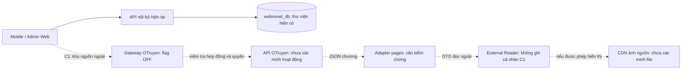
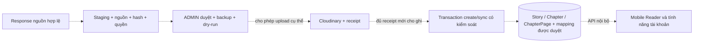

# Nghiên cứu tích hợp OTruyen vào WebNovel

Ngày khảo sát: **20/10/2026, Asia/Saigon**. Trạng thái: **CHỈ NGHIÊN CỨU — CHƯA TRIỂN KHAI**.

## 1. Kết luận và giới hạn xác minh

WebNovel đã hỗ trợ COMIC nhiều chương, mỗi chương nhiều ảnh. Khó khăn chính của việc tích hợp là hợp đồng API bên ngoài, định danh, liên kết dữ liệu người dùng, độ sẵn sàng và quyền sử dụng; không phải schema hiện tại chỉ cho một ảnh/chương.

**Trong lượt khảo sát này chưa xác minh được OTruyen catalog API đang hoạt động.** `otruyenapi.com` vẫn trả HTTP, nhưng trang gốc báo website đã dừng và bốn đường dẫn API đã thử trả nginx 404 HTML. `docs.otruyenapi.com` tự redirect về chính URL. Không suy ra dịch vụ đã ngừng vĩnh viễn hoặc mọi mạng đều gặp cùng kết quả.

Vì không có catalog JSON hợp lệ, đã lấy **0 mẫu truyện, 0 mẫu chương**, không tạo slug/chapter ID giả để gọi tiếp, không tải file ảnh. Không có JSON thành công của OTruyen để trích dẫn. Các phần thiết kế/mapping phía dưới là **đề xuất có điều kiện**, không phải hợp đồng API hiện hành đã xác nhận.

Đề xuất: **C — kết hợp nguồn nội bộ và nguồn ngoài, triển khai từng giai đoạn**, bắt đầu bằng khu vực đọc ngoài tách biệt, mặc định tắt. Chỉ xây POC live sau khi có endpoint hoạt động, hợp đồng và điều kiện sử dụng rõ ràng. B là lựa chọn cho các tác phẩm được cấp quyền lưu/phân phối cụ thể, không phải thao tác tiếp theo tự động.

## 2. Phương pháp và bằng chứng

- 11 request HTTPS GET trực tiếp, tuần tự, khoảng cách chủ động ít nhất 2 giây trong các nhóm khảo sát sau; hai request robots ban đầu cách 1,5 giây. Không thử tải lớn, tăng tải để đo quota, đổi User-Agent/proxy hoặc vượt chặn. Không retry tự động, không theo vòng redirect tự trỏ.
- Đọc robots trước nội dung trên domain API và docs. Robots API quan sát được chỉ có phần comment giải thích content signals, không có directive User-agent/Disallow/Crawl-delay trong body đã nhận; đây **không phải giấy phép nội dung**. Robots CDN cũng được kiểm tra trước khi dự định lấy mẫu; không có request file ảnh sau đó.
- Tra cứu web công khai để tìm tài liệu/địa chỉ có căn cứ; kết quả chỉ mục và mã client lịch sử không được tính là response API live.
- Chỉ đọc code Backend/Mobile/Admin Web. Truy vấn SQL dùng kết nối `default_transaction_read_only=on`, transaction `REPEATABLE READ READ ONLY`, kiểm tra SQL identity đúng `webnovel_db/public`.
- Chỉ GET một API chương nội bộ để đối chiếu định dạng nhiều ảnh; không gọi auth, favorites, history, progress hoặc API ghi.

Bằng chứng máy đọc được:

- [Kết quả GET OTruyen](backend/docs/research/otruyen-2026-10-20/api-survey.json): status, hostname, response type, redirect, header quota/CORS được kiểm tra và preview rút gọn.
- [Đối chiếu WebNovel](backend/docs/research/otruyen-2026-10-20/webnovel-review.json): số lượng SQL và mẫu API nội bộ.
- [File mã nguồn đã đọc](backend/docs/research/otruyen-2026-10-20/reviewed-files.json): hash file; không lưu .env hoặc credentials.

## 3. Endpoint/hostname đã kiểm tra

Các URL dưới đây là các request đã gửi hoặc trạng thái chưa thể kiểm tra, **không phải danh sách endpoint thành công**.

| Mục đích | GET / hostname | Kết quả quan sát |
|---|---|---|
| Docs robots | `https://docs.otruyenapi.com/robots.txt` | 301, Location trùng URL hiện tại; không theo vòng |
| Tài liệu | `https://docs.otruyenapi.com/` | 301, Location trùng URL hiện tại; 0 byte body |
| API robots | `https://otruyenapi.com/robots.txt` | 200 text/plain; phần comment, không có directive hạn mức/crawl-delay trong body quan sát |
| Trang chủ API | `https://otruyenapi.com/v1/api/home` | 404 text/html, nginx |
| Danh sách | `https://otruyenapi.com/v1/api/danh-sach/truyen-moi?page=1&limit=3` | 404 text/html, nginx |
| Tìm kiếm | `https://otruyenapi.com/v1/api/tim-kiem?keyword=one&page=1&limit=3` | 404 text/html, nginx |
| Thể loại | `https://otruyenapi.com/v1/api/the-loai` | 404 text/html, nginx |
| Trang gốc | `https://otruyenapi.com/` | HTTP 200 HTML, title **Sorry, the website has been stopped**; không phải JSON API thành công |
| Candidate hostname phụ | `https://api.otruyenapi.com/robots.txt` | Không có HTTP response; DNS `ENOTFOUND`. Chỉ kiểm tra hostname ứng viên, không coi đây là host chính thức |
| Chapter CDN robots | `https://sv1.otruyencdn.com/robots.txt` | Không có HTTP response trong lượt thử; lỗi network/timeout, chưa chốt nguyên nhân |
| Cover CDN robots | `https://img.otruyenapi.com/robots.txt` | 200 text/plain; **không xác minh được file ảnh cụ thể** chỉ bằng robots |
| Chi tiết truyện | Candidate `/v1/api/truyen-tranh/{slug}` | Chưa gọi: không có slug lấy từ API live |
| Truyện theo thể loại | Candidate `/v1/api/the-loai/{slug}?page=...` | Chưa gọi: không có genre slug lấy từ API live |
| Nội dung chương | URL `chapter_api_data` do chi tiết truyện cung cấp | Chưa gọi: không có URL chương từ response hợp lệ; không tự chế ID/CDN endpoint |

`limit=3` là giới hạn xin trong request, **chưa chứng minh API nhận tham số limit hoặc giá trị mặc định/tối đa**. Không có ba tác phẩm mẫu vì cả catalog và search đều không trả JSON. Không xác minh số chương/trang tiếng Việt thực tế của một tác phẩm OTruyen nào trong lượt này.

### Phân trang, rate limit, auth và CORS

| Vấn đề | Kết luận hiện tại | Cần xác minh trước POC |
|---|---|---|
| Pagination | Request có page/limit nhưng không có JSON thành công | Trường tổng/trang, base 0/1, limit tối đa, ổn định khi có truyện mới |
| Rate limit | Không có Retry-After/quota header ở các response API lỗi đã đo; không gặp 429 | Quota chính thức, burst, cache, thời gian chờ; không suy ra unlimited |
| Authentication | Không gửi token/API key; chỉ nhận 404 | API có cần key/quyền riêng hay không; 404 không chứng minh public/no-auth |
| CORS | Response API 404 không có Access-Control-Allow-Origin | Response thành công cho Expo Web/Admin Web; Android native không chịu CORS của trình duyệt |
| Hotlink ảnh/CDN | Chưa GET một ảnh nào | HTTPS, thời hạn URL, redirect, policy referer/auth, quyền hiển thị ảnh |
| SLA/version | Không có tài liệu live đọc được | Versioning, thông báo đổi host/schema, cơ chế hỗ trợ khi outage |

## 4. JSON mẫu: phân biệt dữ liệu đo và response API

### 4.1 Kết quả đo thật được biểu diễn bằng JSON

Đây là **bản ghi khảo sát tự tạo**, không phải JSON do OTruyen trả. Body upstream là HTML 404, nên không có chuyện parse ra `data.items`.

```json
{
  "request": "GET https://otruyenapi.com/v1/api/home",
  "httpStatus": 404,
  "contentType": "text/html",
  "jsonResponse": null,
  "storySamples": 0,
  "chapterSamples": 0
}
```

### 4.2 Response WebNovel đã kiểm tra

`GET /api/chapters/:id` của tập 3 Pepper & Carrot trả HTTP 200 và **8 phần tử pages**. File `webnovel-review.json` lưu hai phần tử đầu của response thật; `actualPageCount=8` nằm ngoài preview để không nhầm bản rút gọn với response thiếu ảnh. Không tạo JSON truyện OTruyen giả thay cho mẫu chưa lấy được.

### 4.3 Tên trường OTruyen cần kiểm chứng

Một client mã nguồn công khai cũ dùng các tên `chapter_api_data`, `chapter_image`, `chapter_path`, `domain_cdn` và `image_file`; client ghép domain, path và tên file ảnh. Đây là bằng chứng về **cách client đó được viết**, không phải xác nhận dịch vụ hiện hành. Repository đã archive, không dùng nó để kết luận endpoint còn sống, quota hoặc giấy phép. [Mã client lịch sử](https://github.com/KotatsuApp/kotatsu-parsers/blob/master/src/main/kotlin/org/koitharu/kotatsu/parsers/site/vi/OTruyenParser.kt).

Không có ví dụ URL trang cụ thể đã xác minh. Nếu response live sau này xác nhận đúng hợp đồng nêu trên, công thức ứng viên là:

```text
pageUrl = domain_cdn + "/" + chapter_path + "/" + image_file
```

Phải chuẩn hóa dấu `/`, kiểm tra URL HTTPS/hostname/path và hợp đồng encode trước khi dùng, không ghép mù. `chapter_api_data` là đầu mối để lấy JSON chương nếu provider xác nhận, **không mặc định nó là URL ảnh**. `chapter_image` dự kiến là danh sách cần kiểm tra phần tử/index; không suy ra index bắt đầu 0 hay 1. Chỉ sort bằng trường thứ tự đã được xác nhận; không sort tên file theo chữ khiến `1,10,2`, không dùng mỗi panel làm một trang. Nếu không có index đáng tin, phải xác nhận thứ tự mảng với provider, không tự suy đoán.

Ảnh bìa: client lịch sử dùng `thumb_url` với host ảnh và đường dẫn uploads/comics. Chưa xác minh response hiện tại trả filename, relative path hay absolute URL; **không hardcode công thức đó vào ứng dụng ở bước này**.

## 5. WebNovel hiện tại đã hỗ trợ gì?

### Dữ liệu và quan hệ

- `Story.id`, `Chapter.id`, `ChapterPage.id` và các FK là UUID.
- Story có nhiều Chapter; Chapter có nhiều ChapterPage. Unique `(storyId, chapterNumber)` và `(chapterId, pageNumber)`; chỉ số chương/trang là Int dương.
- Story cần `authorName: string`, type NOVEL/COMIC, status ONGOING/COMPLETED, publishStatus DRAFT/PUBLISHED, createdBy là User. Nội dung mới chỉ được quản trị bởi ADMIN ACTIVE.
- Chapter COMIC có content null, nhiều trang có imageUrl; `storagePublicId` nullable. Chưa có `provider`, externalId, source-server mapping, sync cursor hoặc chính sách quyền trong schema.
- Publish chương COMIC yêu cầu parent PUBLISHED và ít nhất một trang. DTO trang/Reader giới hạn **tối đa 200 ảnh/chương**; DB không có giới hạn 200 tương ứng. Không được cắt bớt trang nguồn để ép vừa DTO nếu nguồn vượt giới hạn.
- Reader nhận toàn mảng ảnh, sort pageNumber, dùng FlatList; initialNumToRender=2 chỉ là cửa sổ render, không phải tổng số trang. Restore ở trang đã lưu có nút tải các trang trước.

### API và tính năng phụ thuộc định danh

- Public: `/api/stories`, `/api/stories/:id`, `/api/stories/:storyId/chapters`, `/api/chapters/:id`; ID đang được validate UUID.
- API tạo truyện hiện ở POST `/api/stories` với authenticate + ADMIN; API chương quản trị ở `/api/admin/...`. Không giả định mọi API ghi truyện đều có prefix admin, và không thay các route hiện có.
- Favorite, Rating, Comment FK đến Story thật trong PostgreSQL. ReadingProgress/ReadingHistory FK đến Chapter và có quan hệ ghép bảo đảm chapter thuộc story.
- Mobile `isUuid`, catalog adapter và route Reader không nhận external slug/ID tùy ý. `useReadingSync` dùng API tiến độ/history khi đã đăng nhập. Không thể đưa một UUID tự băm nhưng chưa có hàng DB vào các API đó để vượt FK.
- Schema đã đủ cho **nhập một chương nhiều ảnh**. Chưa đủ provenance/sync cho nhà cung cấp ngoài lâu dài, và chưa thể tự dùng các tính năng cá nhân với dữ liệu chỉ tồn tại upstream.

### 25 tác phẩm hiện có

SQL chỉ đọc hiện thấy **26 Story tổng cộng**: 10 thuộc sample-library-v1 + 15 thuộc library-expansion-v2 = **25 tác phẩm đã import**, cộng 1 Story khác có sẵn. Tổng loại: 16 NOVEL, 10 COMIC. Đây là phân biệt phạm vi để bảo vệ cả hàng ngoài hai danh mục, không đề xuất xóa hàng dư.

Cả ba phương án phải giữ nguyên UUID/slug/chương/trang và dữ liệu người dùng của toàn bộ thư viện đang có; không nhập lại, reset, gán lại thể loại hoặc gắn provider OTruyen cho các bản hiện hữu.

## 6. Mapping OTruyen → WebNovel: thiết kế có điều kiện

**Chưa có schema JSON live để chốt mapping.** Cột nguồn là tên trường/cấu trúc cần kiểm chứng, không phải tuyên bố API hiện trả đúng như vậy. Các xử lý cột phải là tiêu chí adapter tương lai, không có code/schema nào được sửa.

| Dữ liệu nguồn cần xác nhận | Đích WebNovel / adapter | Cách xử lý cần duyệt |
|---|---|---|
| ID nhà cung cấp, slug | provider-scoped external key; UUID nội bộ nếu có registry thật | Không dùng title làm identity. Unique theo provider + external key; slug đổi không được tạo truyện trùng |
| name / origin_name nếu có | title; tên gốc metadata | Chuẩn hóa độ dài, giữ nguồn; không đồng nhất mọi tác phẩm trùng tên |
| author nếu là mảng/thiếu | authorName | Ghép theo quy tắc đã duyệt, giữ đủ tác giả; thiếu tác giả đưa vào biên tập, không gán tên giả |
| content nếu HTML | description plain text | Sanitize/convert; không thực thi script, iframe hoặc chèn HTML tùy ý |
| status nguồn | status + publishStatus tách biệt | Không coi ongoing là PUBLISHED; trạng thái sắp ra mắt/khác cần quy tắc, không ép thành completed |
| category nếu có | Genre + StoryGenre / external genre DTO | Map theo nguồn, kiểm tra trùng slug/name; không đổi Genre đang có |
| thumb_url / CDN bìa | coverUrl | Xác nhận absolute/relative, HTTPS, quyền hotlink hoặc quyền upload; không coi HTTP 200 là giấy phép |
| Danh sách chapters và server_data nếu có | danh sách Chapter / ExternalChapter | Phân biệt nhiều server/bản dịch; không flatten thành chương trùng hoặc tự chọn bản khác |
| chapter_name / title | chapterNumber và title | ChapterNumber nội bộ Int; phải giữ tên gốc riêng trong provenance. Kiểm tra chương 0, lẻ, special; không parseInt làm mất ý nghĩa |
| chapter_api_data | khóa/URL nguồn chương trong mapping | Allowlist và SSRF guard; không nhận URL upstream tùy ý từ client |
| domain_cdn, chapter_path | phần dựng URL | Xác minh host/path thực tế; có thể thay đổi, không phải ID nội bộ |
| chapter_image và trường thứ tự nếu có | ChapterPage.pageNumber 1…N | Xác minh thứ tự, không thiếu/trùng; lưu mapping chỉ số gốc nếu cần; không tách panel |
| image_file nếu có | imageUrl sau ghép, hoặc URL Cloudinary được phép | Không upload nếu chưa được cấp quyền. `storagePublicId=null` cho ảnh không lưu trên Cloudinary, không tự tạo publicId giả |
| Ngày cập nhật / hash phiên bản | sync revision riêng, không giả thay updatedAt | Giữ optimistic concurrency nội bộ; phát hiện thay đổi danh sách trang trước khi cập nhật progress |

## 7. So sánh A / B / C

| Tiêu chí | A — đọc realtime | B — đồng bộ vào PostgreSQL, ảnh Cloudinary khi có quyền | C — nội bộ + ngoài cùng ứng dụng |
|---|---|---|---|
| Độ khó | Vừa cho đọc Guest; cao nếu thêm tính năng cá nhân | Cao: provenance, dedup, sync, quyền, receipt/rollback | Vừa cho khu ngoài tách biệt; cao cho UX/tính năng thống nhất |
| Schema | Không cần nếu chỉ đọc Guest/không lưu ngoài | One-off create-only có thể dùng schema cũ + ledger; sync dài hạn nên có mapping model được duyệt | C1 đọc ngoài không lưu: không cần; C2 có tính năng cá nhân: cần registry/FK hoặc mô hình ngoài riêng được duyệt |
| Tài khoản | Giữ JWT nội bộ; không gửi JWT sang OTruyen | Giữ auth; chỉ ADMIN ACTIVE phê duyệt dữ liệu | Giữ auth; nguồn ngoài không có quyền admin nội bộ |
| Yêu thích / lịch sử / tiến độ | Các API DB hiện tại không dùng được với ID chỉ có upstream | Dùng các API hiện tại sau khi tạo đủ Story/Chapter/Page hợp lệ | C1 vô hiệu hóa ghi cho nguồn ngoài; C2 phải có khóa thật và chiến lược riêng |
| Rating / Comment | Không thể gắn vào Story không tồn tại DB | Gắn UUID nội bộ; dữ liệu người dùng không được ghi đè khi sync | Chỉ bật khi reference/store được thiết kế; không trộn bình luận hai nguồn theo title |
| Hiệu suất | Cache/proxy giảm gọi lặp, nhưng mỗi chương/ảnh vẫn phụ thuộc ngoài | Nhanh và ổn định sau sync; tốn lưu trữ, băng thông, công vận hành | Nội bộ độc lập; nguồn ngoài có trạng thái tải/lỗi riêng |
| Outage | Không có cache hợp lệ thì không đọc được ngoài | Bản đã lưu được phép vẫn đọc được; cần theo dõi dữ liệu cũ/takedown | Không để lỗi ngoài làm hỏng Home/Library nội bộ; tắt riêng provider |
| Quyền | Cần quyền truy cập API/hiển thị/hotlink phù hợp | Cần quyền sao chép, lưu và phân phối ảnh, bản dịch, metadata | Cần quyền cho từng luồng, không coi nhãn nguồn là đủ |
| 25 tác phẩm đã import | Giữ nguyên namespace/routes nội bộ | Chỉ tạo nội dung ngoài đã duyệt; không overwrite | Phân nguồn rõ, mặc định internal; không di chuyển dữ liệu cũ |
| Tình trạng hôm nay | Chưa thể POC live vì API chưa xác minh | Chưa đủ endpoint/hợp đồng/quyền để sync | Có thể duyệt thiết kế, chưa bật tích hợp live |

### A — phạm vi triển khai nếu được duyệt sau này

Backend proxy đọc được ưu tiên hơn gọi trực tiếp từ Mobile để kiểm soát cache, timeout và lỗi. Không bắt buộc sửa Backend nếu gọi trực tiếp, nhưng CORS Expo Web, quản lý host và xử lý API đổi định dạng sẽ khó đồng bộ hơn. Proxy không giải quyết được provider ngừng hoạt động hoặc quyền nội dung.

File mới dự kiến: `backend/src/integrations/otruyen/{client,adapter,validation}.ts`, config và route/controller riêng cho external. Mobile thêm API/query/types và route đọc ngoài; reuse ComicContent trình bày ảnh nhưng **không reuse nguyên ReaderScreen/useReadingSync** khi chưa có đối tượng DB thật. Admin Web không cần sửa nếu chỉ browse/read ngoài. Đây là danh sách dự kiến, chưa tạo file.

Không gọi private history/progress/favorite cho nguồn ngoài ở chế độ C1/A; kể cả người dùng đang đăng nhập, UI cần nói rõ dữ liệu ngoài chưa hỗ trợ đồng bộ tài khoản. Không tự lưu sang Database hoặc âm thầm thay bằng local storage chứa lịch sử cá nhân nếu chưa duyệt.

### B — đồng bộ có kiểm soát

Ngoài client/adapter, cần staging/manifest, CLI hoặc job quản trị được phê duyệt, dedup theo nguồn, cache/version, upload receipt và báo cáo dry-run. Reference ADMIN hiện có; không tạo tài khoản hệ thống mặc định. Nội dung mới DRAFT chờ duyệt, publish là bước có quyền riêng.

Đề xuất mapping model nếu thực hiện sync lâu dài: `ExternalStoryMapping`, `ExternalChapterMapping` với provider/external key, local FK, phiên bản nguồn/thời điểm sync, server/translation và trạng thái quyền. Chỉ đề xuất; **không viết schema/migration**. Không nên chỉ dựa vào file ledger trên một máy cho nhiều worker hoặc cập nhật lâu dài.

File cũ có thể cần sửa khi triển khai thật: store/service đồng bộ, validation, integration tests; Mobile có thể giữ API nội bộ và Reader nếu mọi DTO đã chuẩn hóa đầy đủ. Admin Web có thể cần trang staging/review quyền, nguồn và sync; không biến nội dung đồng bộ thành truyện tự do chỉnh sửa mà không phân biệt provenance.

Cloudinary upload chỉ sau quyền cụ thể + duyệt số ảnh/byte. Dùng ID xác định, overwrite=false, receipt pending trước gửi, concurrency thấp và dừng khi kết quả mơ hồ. Một transaction DB không rollback được Cloudinary; giữ receipt và dừng để duyệt, không tự xóa ảnh hoặc retry cả job. Không đồng bộ xóa những chapter có ReadingHistory/Progress/FK; giữ trạng thái unavailable và thiết kế rõ soft removal.

### C — đề xuất phù hợp nhất

**C1:** giữ nội bộ nguyên trạng, khu vực nguồn ngoài có nhãn, cache/query key và route riêng, feature flag tắt mặc định. Không giả một tổng pagination bằng cộng hai trang từ hai nguồn. Lựa chọn đơn giản là hai section/tab hoặc DTO catalog mới có pagination/cursor riêng từng nguồn; `/api/stories` hiện tại giữ hợp đồng cũ.

**C2, chỉ khi được duyệt schema và chức năng:** thêm registry dữ liệu ngoài và mapping UUID thực, hoặc materialize có kiểm soát metadata Story/Chapter/Page URL. Tính năng cá nhân chỉ dùng ID có FK hợp lệ. Chỉ tạo Story và Chapter stub nhưng không có trang sẽ không đủ: Backend hiện kiểm tra nội dung COMIC và tiến độ dựa trên pages, nên phải materialize metadata trang hợp lệ hoặc thiết kế nhánh dịch vụ riêng có kiểm chứng. Không tắt kiểm tra FK/publication để lách điều này.

Ở C2 cần duyệt riêng sửa library/history/feedback/query keys Mobile, store/service Backend, hành vi khi nguồn đổi hoặc mất ảnh và mapping page revision. Không chèn content ngoài vào API cũ với UUID băm không tồn tại DB. Không sửa hoặc gắn lại nguồn cho 25 tác phẩm hiện có và Story thứ 26 ngoài danh mục.

## 8. Sơ đồ luồng dữ liệu

Đường liền là hệ thống nội bộ đang có; đường chấm là **đề xuất chưa triển khai**.



Luồng B trong tương lai nếu được duyệt riêng:



## 9. Điều kiện sử dụng và quyền nội dung

Trang docs không đọc được; trang gốc không cung cấp điều khoản dùng API trong response hiện tại. Một bài đăng Admin trên diễn đàn liên kết tài liệu OTruyen trong bối cảnh học frontend; kết quả chỉ mục đó **không phải giấy phép phân phối mọi truyện/ảnh/bản dịch**, không thay điều khoản hiện hành. [Bài đăng tham chiếu](https://forum.ophim.cc/d/27-api-postman-ophim-otruyen).

Hiện chưa có bằng chứng đủ để phê duyệt B hoặc đưa một danh mục OTruyen cụ thể vào thư viện chính. Cần nguồn cung cấp xác nhận về API, cache, hotlink, lưu lại, phân phối, ảnh bìa, trang truyện, bản dịch và attribution/takedown. Phạm vi học tập không tự chứng minh các quyền còn thiếu. Không suy giấy phép nội dung từ license của mã client, robots, HTTP 200 hoặc việc API không đòi key. Không gửi thư/liên hệ thay người dùng.

## 10. Kế hoạch từng bước, chỉ thực hiện sau khi được duyệt

1. **Chốt nguồn:** người dùng/provider cung cấp base URL/docs đang hoạt động và điều kiện dùng; không đoán mirror hoặc vượt cơ chế hạn chế.
2. **Khảo sát lại phạm vi nhỏ:** tối đa 3 tác phẩm, 1–2 chương/tác phẩm, chỉ GET JSON; xác minh index trang/server, chương lẻ/special, host ảnh, pagination/quota/auth. Không bulk ảnh; thử ảnh riêng chỉ khi phạm vi được cho phép. Xuất mẫu thật đã rút gọn.
3. **Duyệt quyết định C1/A/B/C2 và quyền:** xác định tác phẩm/phạm vi được hiển thị hay được lưu; nguồn chưa rõ quyền không đưa vào sync.
4. **POC C1 cô lập:** môi trường test; flag OFF mặc định, API namespace riêng, adapter có Zod và mock fixture; không ghi Database, không gọi Cloudinary. Native/Web được kiểm tra riêng.
5. **Chứng minh không ảnh hưởng nội bộ:** test các DTO/UUID, bộ lọc và pagination nội bộ, Reader nhiều ảnh, auth, favorites/history/progress/comments. Lỗi ngoài phải trả trạng thái ngoài rõ ràng, không làm thư viện nội bộ rỗng hoặc che lỗi bằng success:[] giả.
6. **Nếu chọn tính năng cá nhân hoặc B:** trình duyệt thiết kế registry/mapping/schema riêng trước migration; dùng test DB và fixture được duyệt, không dùng tài khoản thật. Không tự tạo ADMIN.
7. **Nếu chọn sync/upload:** staging/dedup/dry-run/backup, duyệt cụ thể số tác phẩm/chương/ảnh/byte và chính sách publish; xử lý conflict và receipt, có phương án rollback/takedown không xóa dữ liệu người dùng.
8. **Nghiệm thu và bật có giới hạn:** API/ảnh thật, lỗi 404/429/5xx/timeouts, mất mạng/đổi host, cache cũ và bộ dữ liệu nội bộ; có công tắc tắt nguồn ngoài độc lập. Chưa có bước nào được cấp quyền thực thi bằng báo cáo này.

## 11. Rủi ro kỹ thuật cần giải quyết trong thiết kế

- Không tin URL `chapter_api_data` hoặc domain trả về một cách vô điều kiện: HTTPS, allowlist đã xác minh, chặn private/loopback/link-local, không theo redirect tùy ý. Không biến gateway thành proxy URL mở.
- Timeout/cancel, giới hạn body và số trang, validate JSON/content-type; HTML 404 phải thành lỗi upstream, không crash Reader hoặc coi là dữ liệu hợp lệ.
- Quota chưa biết: cache có TTL theo điều khoản, request coalescing, concurrency thấp, honor Retry-After; không benchmark bằng flood hoặc retry không giới hạn. Cache không phải bản offline hợp pháp nếu chưa có quyền lưu.
- Không đưa JWT nội bộ, Refresh Token, Cloudinary secret hoặc API key cần giữ bí mật sang client/provider. OTruyen có auth riêng nếu có, không dùng token WebNovel thay thế.
- Nhiều server/bản dịch, chương trùng tên, đổi slug/URL và revision trang có thể làm sai history/progress. Cần identity/version riêng; không tự ghi đè thay đổi ADMIN hoặc cập nhật số trang làm mất vị trí người dùng.
- Chuẩn hóa metadata/HTML và độ dài, kiểm tra cả body limit Backend và Reader tối đa 200 trang; vượt giới hạn thì dừng/thiết kế lại có duyệt, không cắt mất trang.
- Không mặc định CDN còn sống vì robots trả 200. Không giải quyết hotlink chặn bằng giả referer, proxy vượt chặn hoặc tự rehost lên Cloudinary.
- Feature flag, cache namespace và response schema phải tách rõ internal/external; giữ nguyên dữ liệu người dùng cũ khi provider bị tắt.

## 12. Các quyết định cần chủ dự án duyệt

1. Có base URL và tài liệu chính thức còn hoạt động nào khác để khảo sát lại không? Chưa có địa chỉ mới được xác nhận trong lượt này.
2. Chọn **C1 đọc ngoài tách biệt trước** hay chỉ chấp nhận nội dung đã được cấp quyền nhập B?
3. Nguồn ngoài ban đầu chỉ browse/read, hay bắt buộc có Favorites/History/Progress/Rating/Comments ngay? Trường hợp sau cần duyệt mô hình lưu dữ liệu riêng.
4. Quyền hiển thị/hotlink/cache/sao chép và bản dịch đã được provider/chủ thể quyền xác nhận tới đâu?
5. Trạng thái khi outage: tắt riêng provider, thông báo retry thủ công hay dùng cache theo quyền và thời hạn nào?
6. Nếu sync: có đồng ý đề xuất schema mapping ở giai đoạn sau, chọn server/bản dịch và quy tắc chương special thế nào?
7. Bất kỳ lần ghi DB hoặc upload nào sau này cần duyệt lại phạm vi cụ thể; phê duyệt báo cáo nghiên cứu không phải phê duyệt import.

## 13. Phạm vi hoàn thành hôm nay

Đã tạo tài liệu này và các file bằng chứng khảo sát. Không sửa mã nguồn Backend/Mobile/Admin Web, .env, schema, migration hoặc dữ liệu. Không chạy seed/import, không Cloudinary upload, không tải file ảnh OTruyen, không build APK. Không chạy bộ integration ghi dữ liệu chỉ để làm báo cáo nghiên cứu.

Đã xác minh giới hạn truy cập và khả năng nhiều trang của WebNovel; **chưa xác minh được hợp đồng API OTruyen live, ba mẫu truyện, nội dung chương, quota/auth, URL ảnh thực tế hoặc giấy phép phân phối**. Internet của môi trường có truy cập HTTP được; đây không phải kết luận thiếu quyền Internet của Codex. Dừng ở nghiên cứu để chủ dự án duyệt hướng đi.
